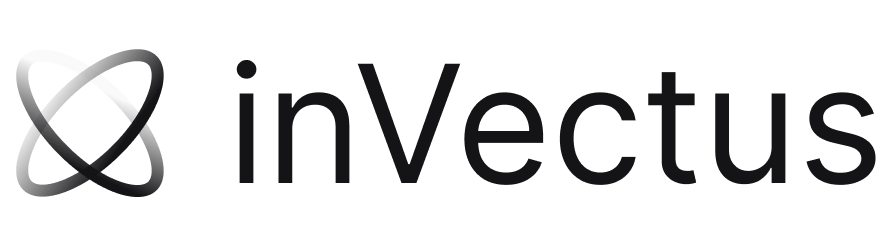
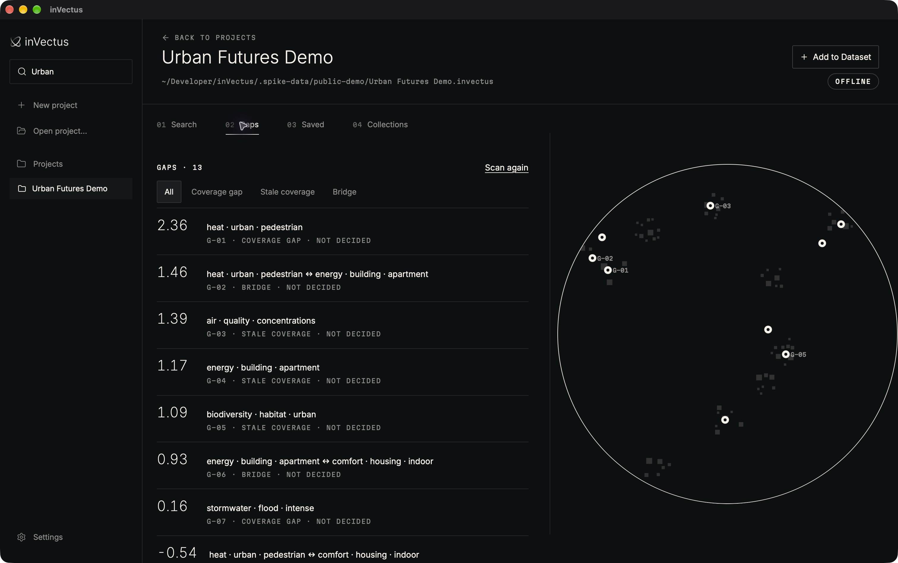
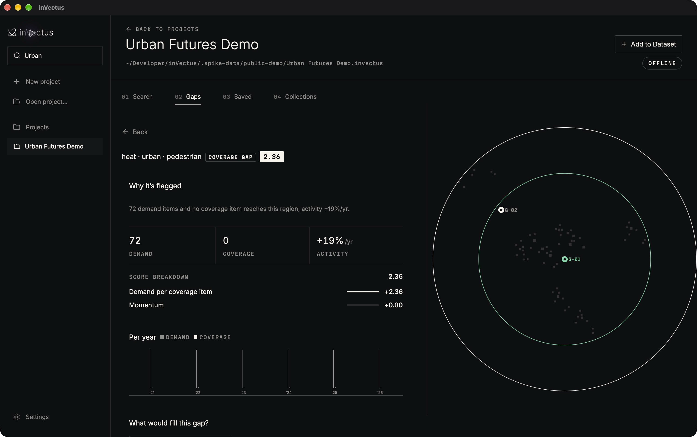
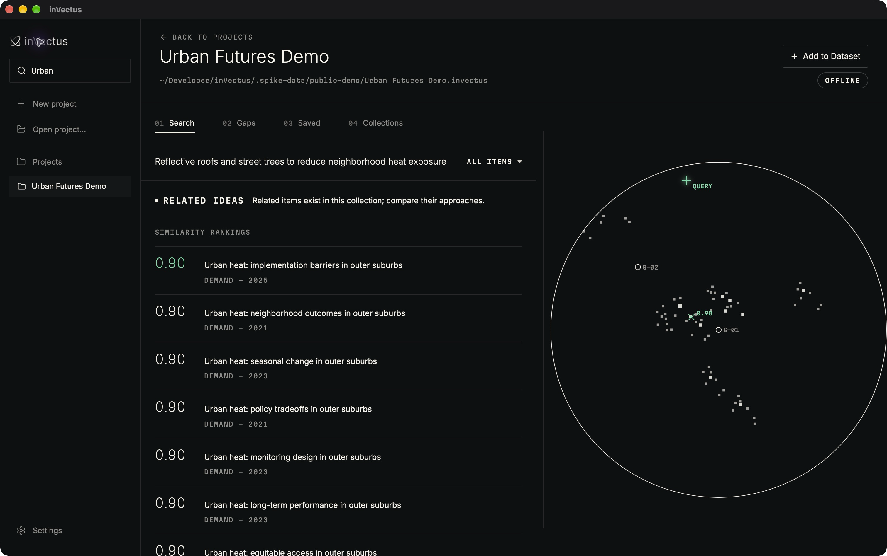
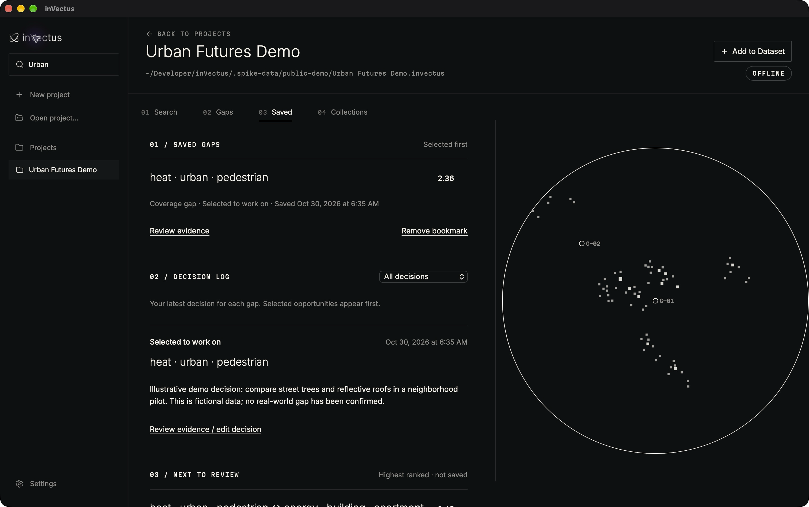

<p align="center">
  
</p>
<p align="center">
  <picture>
    <source media="(prefers-color-scheme: dark)" srcset="src/assets/branding/invectus-logo.png">
    
  </picture>
</p>

# inVectus

**Explore a collection. Find areas with limited coverage. Inspect the evidence.**

inVectus is a local-first desktop research tool that maps document collections,
flags potential gaps, and helps you decide what to investigate next. It combines
semantic search, collection-level assessments, and a persistent decision log in
one workspace.

**Working prototype · MIT licensed · macOS tested locally · Windows/Linux targets unverified**



## What works today

- **Bring your own collection.** Import CSV/TSV, Parquet, or folders of text and
  Markdown files. Map columns and distinguish demand, coverage, and neutral items.
- **Search by meaning.** Compare an idea with your collection, inspect nearest
  items, and view an experimental calibrated `exists / near / open` assessment.
- **Explore potential gaps.** Browse coverage gaps, stale coverage, and possible
  bridges between related regions, with evidence and a score breakdown.
- **Keep your decisions.** Bookmark gaps, record notes and decisions, and return
  to saved work after rescanning.
- **Run locally.** Import, embeddings, search, regions and gap scans run offline.
  Optional model downloads and PubMed/OpenAlex checks require explicit network access.
- **Use the same engine from the terminal.** The desktop app and `invectus` CLI
  share the Rust workspace.

## A typical workflow

1. Import a collection and let the app index it with an installed embedding model.
2. Search for an idea or explore the map and ranked gaps.
3. Open a gap to inspect its supporting items, timeline, and score components.
4. Save it for review, record your decision, and optionally check outside sources.

<details>
<summary>More screenshots: evidence, search, and saved decisions</summary>

### Inspect the evidence



### Search within the collection



### Keep a decision log



</details>

## Try the demo

No private dataset is needed. The [demo generator](scripts/create_demo.py) creates
540 fictional urban-research records using Python's standard library.

```sh
python3 scripts/create_demo.py
```

That produces a CSV under `.spike-data/public-demo/`. Import it in the app, or build
the complete demo after compiling the CLI and installing BGE-small:

```sh
python3 scripts/create_demo.py --build
```

The builder runs offline and never downloads a model. See the
[step-by-step demo](docs/demo.md) for setup, field mapping, sample queries, and
how to reproduce the screenshots.

## Build from source

You need the pinned Rust toolchain, Node.js 24 with npm, Python 3 for the demo,
CMake, Protocol Buffers (`protoc`), and the
[Tauri 2 platform prerequisites](https://v2.tauri.app/start/prerequisites/).
The native Rust dependencies make the initial build substantial; allow several
GB of disk space and time for a full C/C++ build.

```sh
git clone https://github.com/rbaltodano/inVectus.git
cd inVectus
npm ci
npm run build
cargo build --workspace --release --locked
npm run tauri dev
```

If `protoc` is not on `PATH`, set `PROTOC` to its absolute executable path.
No model weights are bundled. See [development and model setup](docs/development.md)
for installation commands, local checks, CLI examples and native packaging.
There is no signed/notarized end-user release promised by this repository.

## Engineering choices

**One engine, two interfaces.** Tauri 2 and React/TypeScript provide the desktop
interface; the same Rust crates implement the CLI. DuckDB stores project metadata,
LanceDB stores vectors, ONNX Runtime runs embeddings, and llama.cpp supports
optional local descriptions.

**Explicit embedding identities.** Each vector table records its model revision,
checksums, tokenizer and text policy. Queries use a matching space; imported
vectors require a recorded runtime-parity check before a different encoder is admitted.

**Inspectable results.** Search can compare every stored vector exactly. Scores,
calibration quality and supporting items remain visible. Map coordinates are for
browsing; region and gap decisions use embedding-space computations.

**Resumable local work.** Embedding jobs checkpoint progress and reuse unchanged
inputs. The desktop serializes background jobs and supports cancellation.

Read the [architecture and tradeoffs](docs/architecture.md) for the data flow and
boundaries between the crates.

## Status and limitations

This is research software under active development. A potential gap means limited
coverage **in this collection**, not global novelty, legal clearance, or proof that
something does not exist. Calibration is approximate; human review is essential.
Synthetic demo results do not validate real-world relevance or discovery quality.

The app is exercised locally on Apple Silicon macOS. Windows and Linux remain
unverified. CI workflows are manual-only; their existence is not evidence of a
passing cross-platform build. Multimodal work is experimental and separate from
the current text workflow. The agent/MCP edition is a [future direction](docs/target-product.md).

Measured experiments, failures and open questions are recorded in
[PROGRESS.md](PROGRESS.md), [the evaluation notes](docs/spikes/README.md) and the
[product specification](SPEC.md). Measurements apply to their stated samples and hardware.

## Contributing and license

Bug reports and focused improvements are welcome. Read [CONTRIBUTING.md](CONTRIBUTING.md)
and [SECURITY.md](SECURITY.md) before sharing project data or logs.

Original inVectus code is [MIT licensed](LICENSE). Dependencies, fonts, icons and
separately installed models retain their own terms; see [third-party notices](THIRD_PARTY_NOTICES.md).

Created by [Ryan Baltodano](https://github.com/rbaltodano).
