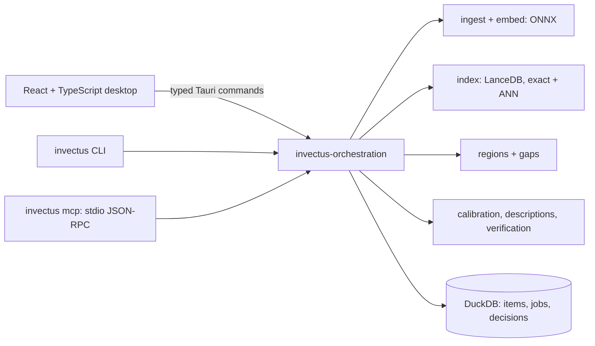

# inVectus: finding where a research collection is thin

**Role:** Ryan Baltodano, solo builder across product framing, interaction design, the
React/TypeScript interface, the Rust engine, evaluation and release tooling. **Status:** v0.2.0
beta for macOS (signed and notarized), Windows and Linux; MIT licensed.
[Website](https://invectus.app) · [Portfolio case study](https://ryanbaltodano.com/invectus.html) ·
[Architecture](architecture.md) · [Progress ledger](../PROGRESS.md)

This document goes deeper than the portfolio page. It covers the decisions, the measurements
behind them and the results that did not go the way they were expected to. Every number below
comes from [PROGRESS.md](../PROGRESS.md), which names its sample and hardware. Most were measured
on one Apple M4 Pro, and none is a claim about collections, domains or machines it was not run on.

## The question

The project started with a practical problem: helping a family member choose a medical school
research topic. Keyword search finds papers, but it does not show where a field has plenty of
primary research and few reviews, or where coverage is old. The working question became:
**where does this collection show demand, limited coverage, older coverage, or a possible
connection between two areas?**

inVectus embeds a collection, builds regions from the embedding-space similarity graph, scores
candidate gaps and keeps the supporting papers next to every score. A person then decides what
is worth pursuing.

What it does not claim: a gap is limited coverage **in the indexed collection**. It is not proof
of novelty, scientific value or absence from the wider literature. Incomplete data, specialist
vocabulary and clustering artifacts can all create apparent gaps. This limit appears in the
interface, the CLI output and every agent tool result, not only in documentation.

## Architecture

One set of Rust crates serves three interfaces: the desktop app, the CLI and an MCP server for
AI agents. Behavior cannot drift between them, because there is only one implementation of
import, search, scoring and job handling. Projects are local folders, and no account or server
is required. The network is used only for explicit model downloads and opt-in verification
connectors, and offline mode refuses both.

## Decisions and tradeoffs

**Embedding identity is recorded, not assumed.** Two vector tables with the same dimension can
still belong to incompatible spaces. Each table records the model revision, weights and tokenizer
checksums, prefixes, template, pooling, normalization, token cap, precision and runtime. Vectors
imported from another tool are searchable only after a parity check against a local encoder. On
a 2,000-paper import of an external dataset, that check found a mean cosine of 0.99907 (n = 200).
It also showed that an earlier spike had assumed the wrong pooling variant. Without the check,
search would have returned plausible-looking scores from a mismatched space.

**Exact search by default.** On the 5,000-paper development sample, approximate search had
recall@10 of 0.974 against exhaustive search, but exhaustive search was faster: 4.6 ms median
versus 5.3 ms. The automatic index threshold was raised from 5,000 to 50,000 vectors. Below that,
the desktop compares every stored vector, so "nothing nearby" is not an artifact of skipped
candidates.

**Regions from the graph, not the picture.** Regions use Leiden community detection on the
embedding-space kNN graph. The 2-D map (MDS plus local PCA) is only a browsing aid, and its
coordinates never decide a region or a score. A visually empty patch on a map is not a gap.

**Scaling found the real thresholds.** Running all 591,484 papers of an existing ophthalmology
dataset exposed two problems the small samples hid. Exact kNN would take hours, so regions above
40,000 items now use an inverted-file approximate kNN that reports its own recall (0.918 at k =
30). A fixed "10 primary studies per review" rule flagged 600 of 709 stable regions, because that
field averages about 28. Coverage gaps now need twice the collection's own ratio. The full run
took 15 minutes with a 6.7 GB peak and produced 769 regions, 709 of them stable.

## Evaluating the score, including where it falls short

A gap score should predict something. The backtest rebuilds the collection as it stood at a
past cutoff (2014, 2016, 2018, 2020), scores gaps, and checks which ones received a review in
the following two years. Weights were tuned with leave-one-cutoff-out, so each result is scored
on a cutoff the tuning never saw.

| Ranking on the held-out cutoff (591k papers, 4 folds) | p@10 | p@25 | AUC |
| --- | --- | --- | --- |
| Tuned weights | 0.500 | 0.370 | 0.623 |
| Original default weights | 0.450 | 0.380 | 0.550 |
| Raw demand count (baseline) | 0.550 | 0.610 | **0.705** |

Tuning improved held-out AUC by 0.073, and the model still trails a plain count of primary
studies. The specification's quality gate fails, and the project records that rather than
hiding it. The likely reason is partly a product question: "where will a review be written next"
rewards large, busy regions, while the score was designed to find where a review is most
needed. Those are different targets, and the backtest measures only the first.

**Calibration.** A collection-level `exists / near / open` verdict needs a calibrated curve. The
first method used paper titles as stand-in queries. Having a local model (Gemma 4 12B) rewrite
each sampled paper as a search idea in its own words improved the held-out result on the same
300 items:

| Calibration method | Held-out AUC | Balanced Brier | Balanced accuracy |
| --- | --- | --- | --- |
| Local model paraphrases | **0.952** | **0.092** | **0.858** |
| Titles only | 0.890 | 0.141 | 0.808 |

The paraphrases are not human-checked, and the specification's hand-labelled evaluation has not
been run. The curve is reported with its method, sample and quality in every verdict.

## Agents as collaborators, with limits

`invectus mcp` is a Model Context Protocol server over stdio, written directly against the
JSON-RPC protocol with no MCP library. It exposes 21 tools over the same orchestration crate the
app uses: reading projects, importing collections, running and cancelling jobs, scanning and
verifying gaps, and writing descriptions, region names and calibration paraphrases.

The design question was trust, not access:

- **Every write records its author.** Decisions store `person` or `agent:<client>/<model>`, taken
  from the client's own handshake.
- **Agents suggest, people decide.** An agent can file a suggestion with required reasoning. It
  appears in the app as a separate, outlined block with Accept, Edit and Dismiss, and it never
  replaces the person's decision. Exports contain decisions only.
- **Agent writing is checked before it is stored.** A gap description from an agent goes through
  the same on-target and novelty checks as the local model's. Rejections come back with reasons
  ("off target … lands nearest region 21"), so the agent can revise.
- **One writer at a time.** DuckDB allows one writing process per project, so the server refuses
  a project the app has open, with a message saying why. A client that disconnects mid-job has
  its job cancelled, so no record is left `running`.

One measured comparison, on one collection with one pass each: an agent (Claude Opus 5.5)
wrote acceptable descriptions for 8 of the top 10 gaps first time, and 10 of 10 after revising
from the rejection reasons. The local model passed 10 of 10 first time. For calibration, the
agent's paraphrases scored lower (held-out AUC 0.866 against 0.952). It followed "in your own
words" literally and swapped field terms for lay ones ("Müller glial cells" became "retinal
support glia"), which moved queries away from the stored text. The proposed fix, keeping
technical vocabulary, is recorded and awaits a product decision because it would also change the
local model's prompt.

Making results compact for agents cut tool-result text by 67% and total input tokens by 24% on a
five-step task in Claude Code (n = 1, not a benchmark).

**Connecting clients.** Each agent client stores its MCP configuration in a different file and
shape. A single catalog table describes every client: its config path, key, entry shape and
detection method. `invectus connect` backs up a config file before merging into it. Clients
configured from documentation but not yet run end to end (Gemini CLI, Kiro, LM Studio, VS Code)
carry an **Unverified** tag in the interface. Claude Code and Codex have been run end to end.

## The interface

The desktop app was designed in Figma first and refined in code. The main workspace splits
evidence and the collection map into resizable panes. The divider supports pointer dragging and
keyboard resizing (arrows, Home and End) as an ARIA separator, and the panes stack when the window
is too narrow for both. A shared jobs provider follows engine events, so moving between screens
does not lose the progress of a long local job.

**Saving is not deciding.** A bookmark keeps a snapshot of a candidate. A decision and its note
are separate records, so a rescan never erases the person's judgment. Frontend regression tests
cover navigation, map focus, search wording, loading states and pane sizing.

## Shipping it

- **v0.1.0 (macOS preview):** a one-line installer at invectus.app that verifies the download
  against published SHA-256 checksums, installs without `sudo`, and refuses a tampered archive.
  Install, upgrade and checksum refusal were tested in an empty home folder.
- **v0.2.0 (beta, three platforms):** the test suite, Clippy and formatting pass in CI on macOS,
  Windows and Linux. Each installer (NSIS, .deb, AppImage, macOS app) was installed on a fresh CI
  runner and run through import, embedding, search, regions and a gap scan. The macOS build is
  signed with Developer ID and notarized.
- **Known limits:** the Windows installer is unsigned, Linux was tested on Ubuntu 24.04 only,
  Intel Macs are not built, and no person has yet tested a clean machine.

## What is not validated

- Whether suggested gaps are useful to researchers. The next step is domain-expert review of
  candidates, and no research discovery or user-outcome result is claimed.
- Large-collection behavior beyond what was measured. A 591k import and gap scan ran, which does
  not validate every workflow at that scale.
- Calibration against hand-labelled queries.

## How it was built

AI coding assistants wrote much of the code. Ryan's ownership is the framing, the system
boundaries, the interaction design, reviewing implementation and checking behavior against the
intended interaction. The progress ledger records measurements with their sample and hardware,
failed approaches and unresolved conflicts with the specification. The case study above
is drawn from that record.
